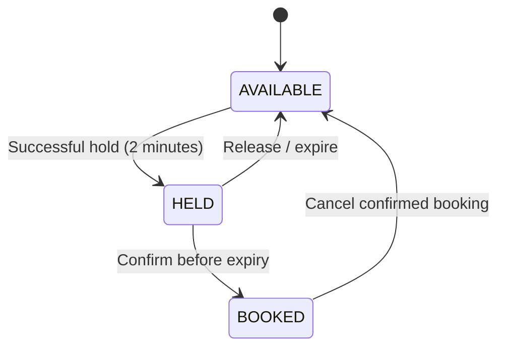
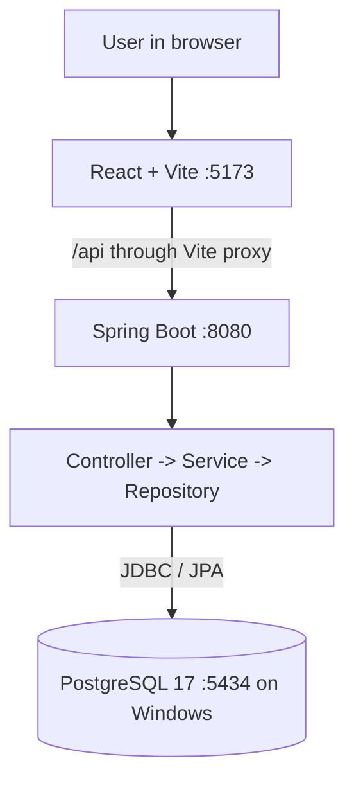

# Concurrent Ticket Booking System

A small, beginner-friendly full-stack project demonstrating **safe concurrent seat booking**. Users can view events, inspect seats, hold a seat for two minutes, restore an active hold after switching demo users or refreshing the page, confirm a booking, view booking history, and cancel a booking.

> **Purpose:** Learn Java 17, Spring Boot, React, PostgreSQL, REST APIs, transactions, and database concurrency. This is a **local learning project**, not a production ticketing/payment system.

## 1. What problem does this solve?

Imagine two users open the same event and both try to reserve seat **A1**. A naïve implementation might let both read `AVAILABLE`, and both think they have booked it.

This application avoids that problem with an **atomic conditional SQL update**. PostgreSQL coordinates updates to the same row, so only one request can successfully claim an available seat. The other receives **HTTP 409 Conflict**. Users booking **different seats** can proceed independently.

### Seat lifecycle



**Note:** An expired hold may still have the stored status `HELD` until an operation reclaims it. The seat-listing API presents expired holds as `AVAILABLE`, and the atomic hold query allows another user to acquire them. No scheduled cleanup is required for this version.

## 2. Technology stack

| Technology | Used for | Why? |
| --- | --- | --- |
| Java 17 | Backend language | Learn Java classes, threads and HTTP services |
| Spring Boot | REST backend | Simplifies APIs and dependency injection |
| Spring Data JPA / Hibernate | Database access | Maps Java entities to PostgreSQL tables |
| PostgreSQL 17 | Persistent data and concurrency | Stores seats/bookings and coordinates row updates |
| Docker Compose | Local PostgreSQL | Repeatable database startup on Windows |
| React + Vite | Frontend | Event cards, seats, booking actions, restored holds and countdown |
| React Router | Frontend navigation | Events, seat selection and bookings pages |
| Postman | Manual API testing | Easy to inspect HTTP request/response behavior |
| IntelliJ IDEA + VS Code | Editors | Backend and frontend development |

No Redis, Kafka, payment integration, or login/JWT is used. Users are deliberately represented by demo IDs **User A** and **User B**.

## 3. Architecture



**Simple explanation:** React is what the user sees; Spring Boot checks the booking rules; PostgreSQL is the permanent record and prevents conflicting seat updates.

**Technical explanation:** HTTP requests enter REST controllers, are handled by services inside appropriate database transactions, and reach PostgreSQL through Spring Data JPA and native conditional SQL updates.

## 4. Project structure

```text
concurrent-ticket-booking/
├── backend/
│   ├── pom.xml
│   ├── mvnw.cmd
│   ├── .mvn/
│   └── src/
│       ├── main/
│       │   ├── java/com/example/booking/
│       │   │   ├── controller/    # EventController, BookingController
│       │   │   ├── service/       # EventService, BookingService
│       │   │   ├── repository/    # Event, Seat, User, Booking repositories
│       │   │   ├── entity/        # Event, Seat, AppUser, Booking
│       │   │   ├── config/        # DemoData
│       │   │   └── BookingApplication.java
│       │   └── resources/
│       │       ├── application.properties
│       │       └── schema.sql
│       └── test/                  # ConcurrencyTest.java, if added
├── frontend/
│   ├── src/
│   │   ├── components/           # Navbar, SeatGrid
│   │   ├── pages/                # EventsPage, SeatsPage, MyBookingsPage
│   │   ├── services/api.js       # All API calls
│   │   ├── App.jsx
│   │   └── index.css
│   ├── package.json
│   └── vite.config.js
├── docker-compose.yml
├── .gitignore
└── README.md
```

## 5. Requirements (Windows)

- Windows 10/11 with PowerShell.
- **JDK 17** (`java -version` and `javac -version`).
- **Docker Desktop**, running with its Linux/WSL2 backend.
- **Node.js 22** and npm (this project was developed with Node v22.23.5 and npm 10.9.9).
- IntelliJ IDEA (for the backend) and VS Code (optional, for React).
- Postman (optional for API testing).
- Maven installation is **not required** if `backend/mvnw.cmd` is present.

Verify:

```powershell
java -version
javac -version
docker --version
docker compose version
docker info
node -v
npm -v
```

If any command fails, fix that tool before continuing.

## 6. Run the project locally

> Commands assume the project lives in `D:\My Learning\PROJECTS\concurrent-ticket-booking`. Change this path if yours is different.

### Step A — Start PostgreSQL

Open **PowerShell**:

```powershell
cd "D:\My Learning\PROJECTS\concurrent-ticket-booking"
docker compose up -d
docker compose ps
```

The local development Compose configuration uses:

| Field | Value |
| --- | --- |
| Container name | `ticket-booking-postgres` |
| Image | `postgres:17` |
| Windows host | `localhost` |
| Windows port | `5434` |
| Container port | `5432` |
| Database | `ticket_booking` |
| Database user | `ticket_user` |
| Development password | `ticket_pass` |

Port **5434** was selected because 5433 was already in use on the development machine.

Verify readiness:

```powershell
docker exec ticket-booking-postgres pg_isready -U ticket_user -d ticket_booking
```

Expected: `accepting connections`.

### Step B — Start Spring Boot

In **another** PowerShell terminal:

```powershell
cd "D:\My Learning\PROJECTS\concurrent-ticket-booking\backend"
.\mvnw.cmd spring-boot:run
```

Alternatively, run `BookingApplication.java` from IntelliJ, using **JDK 17**.

Look for `Started BookingApplication` and a web server listening on **port 8080**.

The local `application.properties` should point to the database:

```properties
server.port=8080
spring.datasource.url=jdbc:postgresql://localhost:5434/ticket_booking
spring.datasource.username=ticket_user
spring.datasource.password=ticket_pass
spring.jpa.hibernate.ddl-auto=update
spring.jpa.defer-datasource-initialization=true
spring.sql.init.mode=always
```

**Security:** Those credentials are *development-only*. Do not reuse them for a deployed application. Move credentials to environment variables before publishing/deploying; do not commit real secrets.

### Step C — Start React

In a **third** PowerShell terminal:

```powershell
cd "D:\My Learning\PROJECTS\concurrent-ticket-booking\frontend"
npm install
npm run dev
```

Open **http://localhost:5173/** in your browser.

The Vite development proxy forwards frontend `/api/...` requests to Spring Boot at `http://localhost:8080`. Keep **all three components running**: PostgreSQL, backend, and frontend.

### Stop / restart

- **React:** Press `Ctrl+C` in the React terminal.
- **Spring Boot:** Press `Ctrl+C` in its terminal, or Stop in IntelliJ.
- **PostgreSQL:** From the project root, run `docker compose down`.
- **Restart PostgreSQL:** Run `docker compose up -d` again.

**Data persistence:** `docker compose down` keeps named volumes. **Do not** run `docker compose down -v` unless you deliberately want to delete the PostgreSQL data volume.

## 7. Main APIs

Base URL: `http://localhost:8080`

| Method | Endpoint | Description |
| --- | --- | --- |
| GET | `/api/users` | List demo users |
| GET | `/api/events` | List events |
| GET | `/api/events/{eventId}/seats` | View seat states |
| GET | `/api/users/{userId}/holds` | Retrieve this demo user’s **active, unexpired seat holds** (new) |
| POST | `/api/seats/{seatId}/hold` | Request a 2-minute hold |
| POST | `/api/seats/{seatId}/confirm` | Confirm an owned, unexpired hold |
| DELETE | `/api/seats/{seatId}/hold?userId={userId}` | Release your hold |
| GET | `/api/users/{userId}/bookings` | View booking history |
| DELETE | `/api/bookings/{bookingId}?userId={userId}` | Cancel a confirmed booking |

**Example: Recover an active hold after refreshing or switching demo users.**

```http
GET http://localhost:8080/api/users/1/holds
```

Example response while User A has a valid hold (IDs and timestamp are illustrative):

```json
[
  {
    "id": 1,
    "seatNumber": "A1",
    "status": "HELD",
    "holdExpiresAt": "2026-11-18T11:32:00Z"
  }
]
```

When User A has no **unexpired** holds, the response is `[]`. This is a **read-only** endpoint: it does not extend the expiry. The frontend matches the returned hold to seats belonging to the currently selected event. The backend verifies the real expiry again when confirmation is requested.

**Example: Hold a seat.** Use an actual available `seatId` returned by the seats API, not an assumed ID:

```http
POST http://localhost:8080/api/seats/1/hold
Content-Type: application/json

{"userId":1}
```

Expected successful response: **200 OK**, `Seat held for 2 minutes`.

If another user already owns a valid hold or the seat is booked, the request returns **409 Conflict**.

**Example: Confirm the hold** (within two minutes):

```http
POST http://localhost:8080/api/seats/1/confirm
Content-Type: application/json

{"userId":1}
```

Expected: a booking object containing a booking ID and `CONFIRMED` status.

**Example: Cancel** (use the booking ID from the confirmation response):

```http
DELETE http://localhost:8080/api/bookings/1?userId=1
```

Expected: cancellation succeeds and the seat becomes available.

## 8. How concurrency safety works

### Unsafe approach

```java
if (seat.isAvailable()) {
    seat.setBooked(true);
}
```

Two requests can both read the old `AVAILABLE` value before either writes an update. This is a **race condition**.

### Our safe approach

```sql
UPDATE seats
SET status = 'HELD',
    held_by = :userId,
    hold_expires_at = clock_timestamp() + INTERVAL '2 minutes'
WHERE id = :seatId
  AND (
    status = 'AVAILABLE'
    OR (status = 'HELD' AND hold_expires_at <= clock_timestamp())
  );
```

The application checks the **number of rows updated**:

- **1 row:** this request acquired the hold.
- **0 rows:** the seat is not eligible (or does not exist); return **409** for an unavailable hold.

PostgreSQL coordinates conflicting updates to the same row. The losing transaction cannot also change the seat from `AVAILABLE` to `HELD` using the outdated state.

**Important distinction:** The 2-minute *business hold* is stored in database columns. It is **not** a two-minute PostgreSQL transaction/row lock. Actual database locks are held only during short transactions.

### Confirming a booking

Within a transaction, the backend:

1. Locks the seat row.
2. Checks it is `HELD` by that user and has not expired.
3. Marks the seat `BOOKED`.
4. Inserts a `CONFIRMED` booking record.
5. Commits both changes together.

If the transaction fails, its changes roll back. A **partial unique index** on confirmed bookings for a seat adds a second layer of protection against duplicate active bookings.

```mermaid
sequenceDiagram
    participant A as User A
    participant B as User B
    participant API as Spring Boot
    participant DB as PostgreSQL
    par Attempt A1 together
      A->>API: POST hold A1
    and
      B->>API: POST hold A1
    end
    API->>DB: Competing conditional updates
    DB-->>API: One succeeds; other affects 0 rows
    API-->>A: 200 OK (example winner)
    API-->>B: 409 Conflict
```

Either user can win; the rule is **only one successful hold**.

## 9. Active-hold recovery: the user-switching fix

### The bug we found

Originally, `SeatsPage` stored the selected hold only in local React state (`heldSeat`). `App.jsx` used `key={userId}` to remount `SeatsPage` when switching between User A and User B. That protected UI state from leaking between demo users, **but erased the previous user’s local hold information**. PostgreSQL still held the seat, so switching back to User A left the Confirm button unavailable even though the hold had not expired.

### How we fixed it

1. `SeatRepository` provides `findByHeldByAndStatus(userId, "HELD")`.
2. `BookingService.getActiveHolds(userId)` filters out expired holds using PostgreSQL time and returns seat ID, number, status, and original expiry.
3. `BookingController` exposes `GET /api/users/{userId}/holds`.
4. `frontend/src/services/api.js` includes `getActiveHolds(userId)`.
5. When the seat page loads or the selected demo user changes, `SeatsPage` fetches **event seats and that user’s active holds**. It restores the matching hold and uses its original `holdExpiresAt` to display remaining time.
6. Confirming still calls the server. The server checks **owner, hold status and expiry** under a row lock before saving the booking.

```mermaid
sequenceDiagram
    participant A as User A
    participant UI as React
    participant API as Spring Boot
    participant DB as PostgreSQL
    A->>UI: Hold A1
    UI->>API: POST /api/seats/{id}/hold
    API->>DB: Store HELD, owner A, expiry
    UI->>UI: Switch to User B
    UI->>UI: Switch back to User A
    UI->>API: GET /api/users/{id}/holds
    API->>DB: Find unexpired holds for A
    API-->>UI: A1 with original expiry
    UI-->>A: Restore Confirm + remaining timer
    A->>UI: Confirm
    UI->>API: POST /api/seats/{id}/confirm
    API->>DB: Validate owner and expiry; BOOKED
    API-->>UI: Booking CONFIRMED
```

**Why this matters:** The browser UI state is temporary; the PostgreSQL hold record is the source of truth. **Switching users or reloading does not renew the hold or give User B access.** For this demo, user selection is not real authentication.

## 10. Testing checklist

Use **real event/user/seat IDs** from the GET endpoints; IDs may differ if the database has been used before.

### Functional tests

| Test | Action | Expected |
| --- | --- | --- |
| List users | `GET /api/users` | Demo users appear |
| List events | `GET /api/events` | Events appear |
| List seats | `GET /api/events/{id}/seats` | Seat availability displayed |
| Hold | User A holds an available seat | 200, seat HELD |
| Duplicate hold | User B immediately holds same seat | 409 |
| Confirm | Owner confirms before expiry | Booking CONFIRMED, seat BOOKED |
| Cancel | Owner cancels booking | Booking CANCELLED, seat AVAILABLE |
| Expiry | Hold without confirmation for >2 minutes | Seat displayed AVAILABLE; another user can hold |
| Persistence | Confirm, restart backend, reload bookings | Confirmed booking still exists |
| Switch user and return | User A holds A1, switch to B, then back to A before expiry | A’s original countdown and Confirm button return |
| Refresh during hold | Refresh as the same demo user before expiry | Active hold is recovered from the backend |
| Wrong-user confirmation | User B attempts to confirm a seat held by A | 409 Conflict |
| Late confirmation | Try confirming after the two-minute expiry | 409 Conflict |

### Concurrent request tests

Use the project's standalone `ConcurrencyTest.java` (if present), which uses `ExecutorService`, `CountDownLatch`, and Java's `HttpClient`.

1. **Same seat:** Choose a fresh available seat. Start User A and User B together against that seat. Expect **one HTTP 200 and one HTTP 409**.
2. **Different seats:** Choose two fresh available seat IDs; send the two user requests together. Expect **HTTP 200 for both**.
3. Repeat with different fresh seats to improve confidence. A single test run does not prove the absence of all concurrency bugs.

**Reported results during development:** Same-seat concurrency, different-seat concurrency, hold expiry, booking confirmation, returning from User B to User A, hold restoration and confirmation before expiry were reported as passing. The user also reported completing the final persistence and edge-case checks. These results are user-reported; they have not been independently reproduced against the local project files.

## 11. Final Windows verification (before sharing)

1. Stop Spring Boot and React, but **do not delete the Docker volume**.
2. Run `docker compose up -d` and check `docker compose ps`.
3. Start the backend and frontend using the commands in Section 6.
4. Visit `http://localhost:5173/`, switch between User A and User B, and check event listings and seat colors. Hold a seat as A, switch to B and then back to A; verify the remaining countdown and Confirm button are restored.
5. Hold and confirm an available seat, then note the booking ID.
6. Restart Spring Boot and refresh **My Bookings**. Verify the confirmed booking remains.
7. Cancel that booking and verify the seat becomes available.
8. Refresh the seat page during an active hold; verify it is recovered without restarting the two-minute timer.
9. Review `git status` and make sure no secrets, `node_modules`, build output, or IDE files are staged.

## 12. Git cleanup

Create a `.gitignore` at the project root if you do not already have one:

```gitignore
# Java / Maven
**/target/
*.class
*.log

# Node / Vite
**/node_modules/
**/dist/

# IDE / OS
.idea/
**/.idea/
*.iml
.vscode/
.DS_Store
Thumbs.db

# Local environment / secrets
.env
.env.*
!.env.example
```

**Do commit:** `src`, `pom.xml`, Maven Wrapper files, `package.json`, lockfile, `vite.config.js`, `docker-compose.yml`, and `README.md`.

**Do not commit:** `node_modules`, compiled output, private credentials, generated database volumes, or `.env` containing secrets.

Useful commands from the project root:

```powershell
git status
git diff --check
```

Optional, if the directory is not yet a Git repository:

```powershell
git init
git add .
git status
git commit -m "Build concurrent ticket booking learning project"
```

Review staged files carefully **before** committing. If you plan to publish the repository, first move the development database password out of checked-in application configuration.

## 13. Troubleshooting

| Problem | What to check |
| --- | --- |
| `port is already allocated` | Check the host port in `docker-compose.yml` and whether another program/container uses it |
| PostgreSQL unavailable | Is Docker Desktop running? Check `docker compose ps` and `docker compose logs postgres` |
| Spring Boot cannot connect to DB | Verify URL, port **5434**, database name, credentials, and PostgreSQL health |
| Port 8080 already in use | Stop the conflicting backend or change `server.port` **and** Vite proxy target |
| React cannot fetch events | Verify backend is running and `/api` proxy points to `http://localhost:8080`; restart Vite after editing `vite.config.js` |
| All seats look held/booked | Use another available seat, release/cancel appropriately, or wait until the hold expires |
| Confirm missing after changing users | Verify `/api/users/{userId}/holds` returns the original unexpired hold and the seat page restores it on user change |
| Timer restarts after refresh | Use the server-provided `holdExpiresAt`, not a new two-minute timer on the client |
| Both test requests return 409 | Seat was not available; pick a fresh seat |
| Backend returns 500 for seat listing | Check console logs and the `databaseNow()` timestamp result conversion |
| `mvn` not recognized | Use `.\mvnw.cmd` from the backend folder |

## 14. Interview explanation (MCA / internship)

**30-second project introduction**

> I built a local Concurrent Ticket Booking System using Java 17, Spring Boot, React, and PostgreSQL. Users can browse events, view seats, temporarily hold a seat for two minutes, confirm or cancel bookings, and view booking history. The main learning goal was preventing double booking when two users request the same seat. I used an atomic conditional PostgreSQL update and short database transactions, then tested simultaneous requests with Java threads.

**Common questions and short answers**

- **What is concurrency?** Multiple tasks progressing during overlapping periods of time.
- **What is a race condition?** When concurrent operations can produce an incorrect result because they act on shared state without proper coordination.
- **Why not just check `AVAILABLE` in Java?** Another request may update the seat after our check and before our write.
- **Why PostgreSQL?** It stores records persistently and provides transactional row-level concurrency control.
- **Why a two-minute hold?** The user gets time to confirm, but an abandoned hold eventually allows another user to book.
- **Why not lock the database row for two minutes?** Long-running transactions waste resources and block other operations; our hold is stored as data and expires by timestamp.
- **What does `@Transactional` do?** It groups related database changes so they commit or roll back together.
- **How did you test double booking?** Two Java threads sent hold requests for the same seat; the expected outcome was one success and one conflict.
- **Why React?** It provides a straightforward UI for viewing events, selecting seats and displaying the timer.
- **What frontend bug did you solve?** Switching demo users reset React’s local hold state. I added an active-holds API so the frontend reloads the owner’s unexpired hold and its original expiry from PostgreSQL.
- **What would you improve for production?** Real authentication/authorization, stronger validation, automated integration tests, idempotent operations, payment handling, monitoring, migrations, and more robust multi-tab/session behavior.

## 15. Scope and limitations

This is intentionally **not** a commercial ticket platform:

- No real account login or authorization. User IDs are demo values, and this should not be internet-exposed as-is.
- No payment or ticket QR generation.
- The React hold countdown is a UI convenience; the backend/database decides whether a hold is actually valid.
- The frontend now restores an active hold after refreshing the seat page or switching back to its owner. It still does not offer production-grade cross-tab synchronization, authentication or automatic hold management across multiple concurrent sessions.
- Event IDs and seat IDs may change depending on prior local database state.
- Database schema auto-update and initialization scripts are convenient for learning but should be replaced by explicit migrations for deployment.

**Learning outcome:** Demonstrates a complete local React-to-Spring-Boot-to-PostgreSQL application, with special emphasis on atomic seat holds, short transactions, expiry, persistence, concurrent-request testing, and restoring frontend state from backend data.
